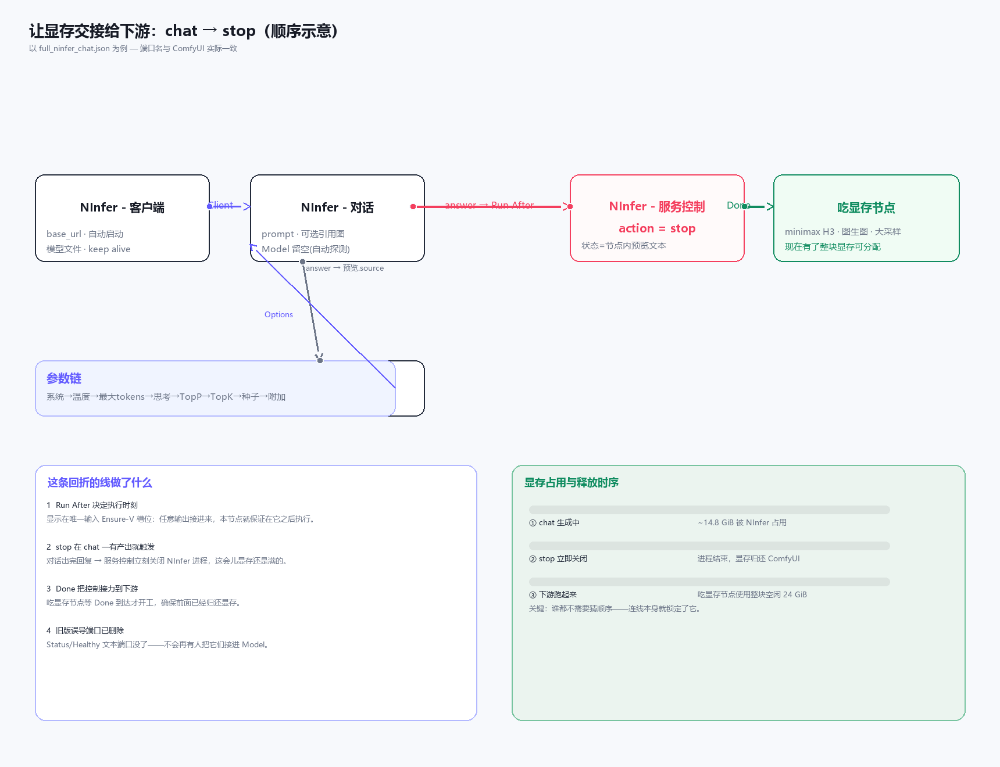

# NInfer example workflows — wiring guide

**English** | [中文](README.zh.md)

Two ready-to-run graphs. Open them by dragging the `.json` onto the ComfyUI
canvas, or **Workflow → Open**.

The graphs are stored in ComfyUI's API (runnable) format, so both the connection
shape and every node's default value are visible and editable once loaded.

## The one rule that prevents every wiring bug

The naive first version shipped **Status / Healthy** outputs on the Server Control
node as connectable text/boolean ports. Someone wired them into the Chat node's
**Model** input and the request failed with:
`model '运行中\n健康: 是\n进程号: ...' not found` — the server received a status
*report* where it expected a *model id*.

That trap is now closed at the source: **Server Control no longer emits
connectable text/boolean ports.** The status report is shown only as preview text
inside the node body. Its sole output is a dedicated control signal (**Done**)
used purely to sequence execution — it physically cannot feed a data input.

**Still, keep Chat's Model blank** — it auto-detects the server's first model id.

## `minimal_ninfer_chat.json` — the smallest correct graph

Three nodes, three hooks:

```text
NInfer - Client ──Client──▶ NInfer - Chat ──answer──▶ Preview Any
```

| Step | Connection | Why |
|---|---|---|
| 1 | **Client.Client** → **Chat.Client** | Gives the chat node the server endpoint (base URL + auto-start + model file). |
| 2 | **Chat.answer** → **Preview Any.source** | ComfyUI refuses to run a graph with no output node, so this terminal node displays the reply. |
| 3 | Leave **Chat.Model** blank | Auto-detects the first model the server reports. |

Everything else is defaults. This is the baseline to debug against: if a run
feels broken, reduce to this graph first.

## `full_ninfer_chat.json` — all nodes connected

Adds the Server Control node and the full options chain:

```text
NInfer - Client ──Client──▶ NInfer - Chat ──answer──▶ Preview Any
                                  ▲ options              │
                                   │                     Run After (daisy-chains back)
  System Prompt ─▶ Temperature ─▶ Max Tokens ─▶ Reasoning Effort ─▶ Top P ─▶ Top K ─▶ Seed ─▶ Extra Body
```

| Step | Connection | Why |
|---|---|---|
| 1 | **Chat.answer** → **Server Control.Run After** | Makes Server Control run only after the chat produces its reply. This example sets action to `stop`, so NInfer is torn down as soon as the reply lands, returning VRAM to any GPU-hungry downstream. Note this wire *doubles back* from the chat |
| 2 | **Client.Client** → **Chat.Client** | As in the minimal graph. |
| 3 | Options **chained left → right**, last one's **Options** output → **Chat.Options** | Each option node reads the previous node's merged settings and adds its own. You can drop any node from the middle of the chain and it still works. |
| 4 | **Chat.answer** → **Preview Any.source** | Terminal output node. |
| 5 | Leave **Chat.Model** blank | Auto-detect (see the rule above). |

> ⚠️ This example sets `action` to `stop` to demonstrate returning VRAM after a
> chat. If you just want to run a chat without freeing memory immediately, set
> `action` back to `ensure running` and disconnect the Server Control's **Run
> After** wire — it then behaves as a standalone node.



The diagram shows the key idea: the wire that **doubles back** from
`Chat.answer` into **Server Control.** Run After** is what turns "run a chat"
into "run a chat, _then_ hand the GPU back". Execution order is locked purely by
the wiring — nobody has to guess. `Done` then hands control to the next
VRAM-hungry node so it only starts once the server is gone.

### The options chain in detail

Every `NInfer - Option*` node has one `Options` input (optional) and one
`Options` output. They are meant to be daisy-chained, and only the *last* node
in the chain feeds the Chat node's **Options** input:

- `System Prompt` — conversation-wide instructions; `skill` appends a markdown
  file from the skills directory.
- `Temperature`, `Top P`, `Top K`, `Max Tokens` — sampling knobs.
- `Reasoning Effort` — `low` / `medium` / `xhigh`; `xhigh` spends many tokens on
  hidden reasoning.
- `Seed` — deterministic sampling; 0 = random.
- `Extra Body` — raw JSON merged into the request body for anything the others
  don't expose.

Because settings are merged node by node, you can reorder or remove any of them
without breaking the graph.